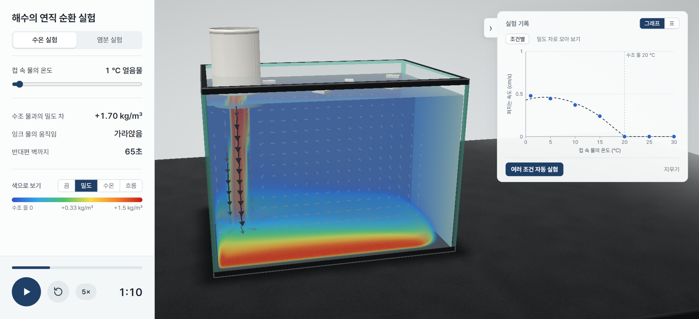
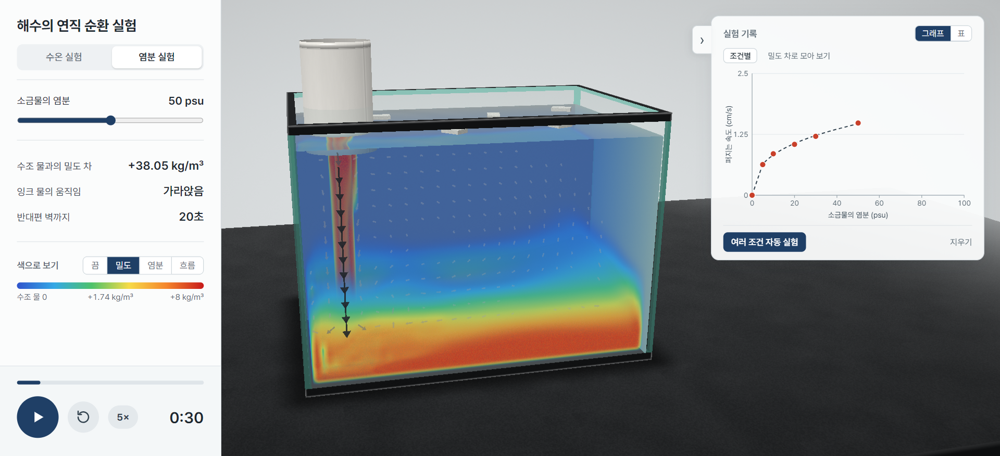

# Ocean Circulation Lab

**사이트:** https://dohye0508.github.io/ocean-circulation-lab/

수온과 염분이 다른 물을 수조에 흘려 넣었을 때 바닷물이 어떻게 가라앉고 아래위로 도는지(해수의 연직 순환) 보여 주는 3D 가상 실험실입니다.

30 × 20 × 20 cm 사각 수조 한쪽 끝에 바닥에 구멍을 뚫은 종이컵을 고정하고, 컵에 잉크를 탄 물을 부어 그 물이 어디로 가는지 관찰합니다.

<table>
  <tr>
    <td></td>
    <td></td>
  </tr>
  <tr>
    <td><b>수온 실험</b> — 컵 속 물의 온도를 바꿉니다. 수조 물(20 °C)보다 차가운 물은 가라앉아 바닥을 따라 반대편 벽까지 퍼지고, 같거나 따뜻한 물은 가라앉지 않습니다.</td>
    <td><b>염분 실험</b> — 수조 물과 온도가 같은 소금물의 염분을 바꿉니다. 소금을 많이 녹일수록 빨리 가라앉아 퍼집니다.</td>
  </tr>
</table>

## 화면 구성

- 왼쪽: 실험 고르기, 조건 슬라이더, 결과(밀도 차, 가라앉았는지, 반대편 벽까지 걸린 시간), 색으로 보기(밀도·수온·염분·흐름), 재생 버튼과 재생 속도
- 오른쪽 위: 실험 기록. 실행할 때마다 퍼지는 속도가 그래프에 점으로 찍히고, `여러 조건 자동 실험`을 누르면 조건을 바꿔 가며 자동으로 점을 채웁니다.
- 수조는 드래그해서 돌리고, 휠로 확대·축소합니다. 수면을 누르고 끌면 잔물결이 생깁니다. 수면에 띄운 스티로폼 조각과 화살표로 물의 흐름을 볼 수 있습니다.

## 실행

폴더를 아무 정적 웹 서버로 열고, Chrome이나 Edge에서 서버 주소로 접속합니다. 예를 들어 Python이 있으면 폴더에서 아래 명령을 실행한 뒤, 터미널에 나오는 주소를 엽니다.

```
python -m http.server
```

## 계산 방법

수조 속 물($30 \times 20 \times 20\ \text{cm}$)을 한 변 $\Delta x = 0.5\ \text{cm}$인 $60 \times 40 \times 40$ 격자로 나누고, WebGL2로 GPU에서 매 단계 $\Delta t = 0.05\ \text{s}$씩 계산합니다. 단위는 cm, g, s를 씁니다.

### 지배 방정식

물은 비압축성이고, 밀도 차는 부력에만 반영하는 부시네스크 근사를 씁니다.

$$
\frac{\partial \mathbf{u}}{\partial t} + (\mathbf{u}\cdot\nabla)\mathbf{u}
= -\frac{1}{\rho_0}\nabla p + \nu \nabla^2 \mathbf{u} - g\,\frac{\rho(T,S)-\rho_0}{\rho_0}\,\hat{\mathbf{z}},
\qquad \nabla\cdot\mathbf{u} = 0
$$

수온 $T$, 염분 $S$, 잉크 농도 $c$는 흐름을 따라 옮겨집니다.

$$
\frac{\partial \phi}{\partial t} + \mathbf{u}\cdot\nabla\phi = 0, \qquad \phi \in \{T,\ S,\ c\}
$$

여기서 $g = 981\ \text{cm/s}^2$이고, $\rho_0 = \rho(T_0, S_0)$는 수조 물(20 °C 맹물)의 밀도입니다. 점성 계수 $\nu = 0.25\ \text{cm}^2/\text{s}$는 0.5 cm 격자에서 계산이 안정되도록 실제 물(약 $0.01\ \text{cm}^2/\text{s}$)보다 크게 잡았습니다.

### 바닷물의 밀도

밀도는 수온·염분에 비례한다고 두지 않고, UNESCO(1981) 해수 상태방정식의 수면 압력 식으로 구합니다. 그래서 순수한 물이 4 °C에서 가장 무거운 성질도 그대로 나타납니다.

$$
\rho(T,S) = \rho_w(T) + A(T)\,S + B(T)\,S^{3/2} + C\,S^2
$$

$$
\begin{aligned}
\rho_w &= 999.842594 + 6.793952\times10^{-2}T - 9.095290\times10^{-3}T^2 + 1.001685\times10^{-4}T^3 \
&\quad - 1.120083\times10^{-6}T^4 + 6.536332\times10^{-9}T^5 \
A &= 0.824493 - 4.0899\times10^{-3}T + 7.6438\times10^{-5}T^2 - 8.2467\times10^{-7}T^3 + 5.3875\times10^{-9}T^4 \
B &= -5.72466\times10^{-3} + 1.0227\times10^{-4}T - 1.6546\times10^{-6}T^2 \
C &= 4.8314\times10^{-4}
\end{aligned}
$$

($\rho$는 kg/m³, $T$는 °C, $S$는 psu) 예를 들어 1 °C 맹물은 20 °C 맹물보다 $1.70\ \text{kg/m}^3$, 20 °C의 50 psu 소금물은 $38.0\ \text{kg/m}^3$ 무겁습니다.

### 한 단계의 계산 순서

1. **이류**: 각 칸에서 흐름을 거슬러 올라간 위치의 값을 가져옵니다(반 단계 속도를 쓰는 2차 역추적). 수온·염분·잉크는 MacCormack 방식으로 보정하고, 주변 8칸의 최솟값~최댓값 범위로 잘라 값이 튀지 않게 합니다.

$$
\hat\phi = \mathcal{A}(\phi^n), \quad \bar\phi = \mathcal{A}^{-1}(\hat\phi), \quad
\phi^{n+1} = \mathrm{clamp}\left(\hat\phi + \tfrac{1}{2}(\phi^n - \bar\phi)\right)
$$

2. **부력과 점성**: 밀도 차에 따른 부력을 더하고, 점성 항은 이웃 6칸으로 만든 라플라시안으로 계산합니다.

$$
w \leftarrow w - \Delta t\, g\,\frac{\rho(T,S)-\rho_0}{\rho_0}, \qquad
\mathbf{u} \leftarrow \mathbf{u} + \Delta t\,\nu\,\frac{\sum_{\text{이웃}} \mathbf{u}_{nb} - 6\,\mathbf{u}}{\Delta x^2}
$$

3. **압력 투영**: 압력을 $\psi = \dfrac{\Delta t}{\rho_0}\,p$로 묶어 푸아송 방정식을 세우고, 야코비 반복 40번으로 풉니다. 그 기울기를 빼서 $\nabla\cdot\mathbf{u}=0$을 맞춥니다. 발산과 기울기는 중앙 차분($\tfrac{1}{2\Delta x}$)으로 구하고, 벽에서는 벽을 뚫고 나가는 속도를 0으로 둡니다.

$$
\nabla^2 \psi = \nabla\cdot\mathbf{u}^{\ast}, \qquad
\psi^{(k+1)}_{i} = \frac{1}{6}\Big(\sum_{\text{이웃}} \psi^{(k)}_{nb} - \Delta x^2\,(\nabla\cdot\mathbf{u}^{\ast})_i\Big), \qquad
\mathbf{u}^{n+1} = \mathbf{u}^{\ast} - \nabla\psi
$$

### 컵에서 나오는 물

컵 바닥 구멍(반지름 0.9 cm) 아래 칸에서는 수온·염분·잉크 농도를 컵 속 물의 값으로, 아래 방향 속도를 $1\ \text{cm/s}$로 서서히 맞춥니다(시간 상수 $\tau = 0.3\ \text{s}$).

$$
\phi \leftarrow \phi + (\phi_{\text{컵}} - \phi)\left(1 - e^{-\Delta t/\tau}\right)
$$

### 결과 값

- **반대편 벽까지 걸린 시간**: 잉크가 바닥(수면에서 19 cm 아래)에 처음 닿은 뒤, 바닥 근처 잉크의 앞쪽 끝이 반대편 벽 3 cm 앞까지 오는 데 걸린 시간입니다.
- **퍼지는 속도**: 그 거리 $L$을 걸린 시간으로 나눈 값입니다.

$$
v = \frac{L}{t_{\text{벽}} - t_{\text{바닥}}}
$$

- **추세선**: 점들의 $\ln v$를 $\ln \Delta\rho$의 2차식으로 최소제곱 맞춤한 곡선입니다. 240초 안에 반대편 벽에 닿지 못한 실험은 추세선에서 뺍니다.
